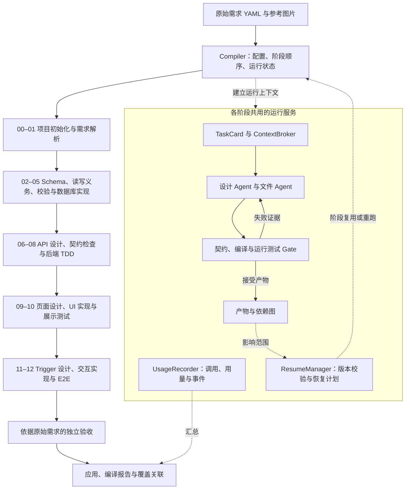

# Requirement Compiler

Compile `requirements.yaml` and reference images into a React + Express + SQLite application through 13 passes: requirements, database schema and obligations, backend APIs and tests, UI, and frontend triggers with end-to-end tests. Intermediate artifacts are saved under the output directory's `.arc/` folder.

## Environment

Install [Python 3.11+](https://www.python.org/downloads/), [Node.js 22.12+ with npm](https://nodejs.org/en/download), and [uv](https://docs.astral.sh/uv/getting-started/installation/). Ensure `node`, `npm`, and `uv` are available in your terminal; reopen it after installation.

Run from the repository root using your platform's shell.

**Windows (PowerShell)**

```powershell
uv sync
if (-not (Test-Path .env)) { Copy-Item .env.example .env }
uv run playwright install chromium
```

**macOS / Linux (bash or zsh)**

```bash
uv sync
if [ ! -f .env ]; then cp .env.example .env; fi
uv run playwright install chromium
```

On supported Debian/Ubuntu Linux systems, use `uv run playwright install --with-deps chromium` instead to also install browser system dependencies; this may require sudo.

If npm needs to compile native dependencies such as `better-sqlite3`, install the platform's build tools:

| Platform | Build tools |
| --- | --- |
| Windows | Visual Studio Build Tools with **Desktop development with C++**, plus Python available to npm. |
| macOS | Xcode Command Line Tools: `xcode-select --install`. |
| Linux | Python, make, and a C++ compiler; on Debian/Ubuntu: `sudo apt-get install python3 build-essential`. |

Set `OPENAI_API_KEY`, `OPENAI_BASE_URL`, and `MODEL` in `.env`. Use a model that accepts image input.

## Run

The input directory must contain `requirements.yaml` and its referenced images. The examples use `input/` and write the generated application to `outputs/demo/`. The commands below work in PowerShell, bash, and zsh.

### Full pipeline

```bash
uv run main.py input --output-dir outputs/demo
```

Add `--model-log` to display and save detailed model input/output, or `--port 33000` to change the backend port (default: 3000). Token usage and model latency are always shown.

### Usage reports and resume

Runs save usage and task metrics to `.arc/usage/usage.json`, provenance to `.arc/dependencies.json`, declared suite ownership to `.arc/coverage.json`, and version-checked state to `.arc/resume.json`. Missing provider token counts remain unknown. Assertion coverage for individual requirement steps is not inferred from suite ownership.

```bash
uv run main.py input --output-dir outputs/demo --resume-preview
uv run main.py input --output-dir outputs/demo --resume-preview --changed-node api:API-register
uv run main.py input --output-dir outputs/demo --resume
```

Preview writes `.arc/resume-plan.json` without running stages. Resume checks input, compiler/template, configuration, artifact and source versions. Changed intermediate designs are preserved and checked by their consumers. Shared stages rerun conservatively; accepted task reuse still checks the current context and acceptance gate.

Context serialization uses compact JSON and literal evidence by default. `--context-dedup` experimentally replaces duplicate evidence with reversible `$context_ref` pointers; compare full-run tokens and acceptance results before enabling it. `--no-context-dedup` remains supported. Hard budgets, explicit task-model routing, accepted-response caching and reviewed simple schema proposals are opt-in experiments; see [implementation details and options](improvement-plan.md#135-实验开关).

```bash
uv run python -m infrastructure.shared.usage.compare outputs/baseline outputs/candidate --output comparison.json
```

The comparison reports usage completeness, outcome changes, token counts, calls and elapsed time. Test failures or unknown token counts cannot establish an equal-outcome token saving.

### Step by step

Run these commands in order. They call the same 13 passes with the same default settings as `main.py`. Step 01 uses `--no-browse` to match the non-interactive pipeline.

```bash
uv run 00_project_initialization.py --input input --output outputs/demo
uv run 01_explore_requirement.py --input input --output outputs/demo --no-browse
uv run 02_build_db_schema.py --input input --output outputs/demo
uv run 03_infer_db_obligations.py --input input --output outputs/demo
uv run 04_check_db_obligations.py --input input --output outputs/demo
uv run 05_implement_db.py --input input --output outputs/demo
uv run 06_design_backend_apis.py --input input --output outputs/demo
uv run 07_check_backend_apis.py --input input --output outputs/demo
uv run 08_implement_backend_tdd.py --input input --output outputs/demo
uv run 09_design_ui.py --input input --output outputs/demo
uv run 10_implement_ui.py --input input --output outputs/demo
uv run 11_design_frontend_triggers.py --input input --output outputs/demo
uv run 12_implement_frontend_tdd.py --input input --output outputs/demo
```

For individual steps, add `--pause` for teaching pauses or `--debug-model-io` for detailed model I/O. Set a custom backend port with `--port` in step 00.

### Start the generated application

```bash
cd outputs/demo
npm run db:init
npm run build
npm start
```

Open `http://localhost:3000` (or the port you selected).

## Code map and extension points


Numbered scripts orchestrate each pass. Domain logic lives in `infrastructure/stages/`; shared agent and project services live in `infrastructure/shared/`.

### Module guide

| Module | Entry | Purpose |
| --- | --- | --- |
| Pipeline | [main.py](main.py), [compiler.py](infrastructure/compiler.py) | Configuration, pass order, and reports. |
| Requirements · 00–01 | [requirements/](infrastructure/stages/requirements/), [project/](infrastructure/shared/project/) | Requirement tree and project initialization. |
| Database · 02–05 | [database/](infrastructure/stages/database/) | Schema, obligations, DDL, and seed data. |
| Backend · 06–08 | [backend/](infrastructure/stages/backend/) | API contracts, HTTP tests, and implementation. |
| Frontend · 09–12 | [ui/](infrastructure/stages/frontend/ui/), [triggers/](infrastructure/stages/frontend/triggers/) | UI design, interactions, and browser acceptance. |
| Agent loops | [proposals.py](infrastructure/shared/agent/proposals.py), [loop.py](infrastructure/shared/agent/loop.py) | Model requests, file edits, checks, and repair. |
| Runtime services | [project/](infrastructure/shared/project/), [presentation/](infrastructure/utils/presentation/) | Templates, Git checkpoints, logs, and execution evidence. |

### Extension points

| Area | Current entry | Possible extension |
| --- | --- | --- |
| Memory | [conventions.py](infrastructure/shared/agent/conventions.py) stores shared decisions; task loops retain retrieved evidence. | Store validated repair lessons and retrieve only those relevant to the current task. |
| RAG | [rag/](infrastructure/shared/rag/) provides BM25; [discovery.py](infrastructure/shared/agent/discovery.py) provides lexical search and exact reads. | Add embeddings, hybrid retrieval, or reranking to the relevant retrieval path. |
| Tools | [tools/](infrastructure/shared/agent/tools/) registers and executes `read_file` and `edit_file`. | Add tool schemas, executors, permissions, and observation handling in `loop.py`, including external service adapters. |
| Skills | No loader is implemented. | Select task-relevant `SKILL.md` guidance when assembling prompts, using the existing tools and permissions. |
| Models | [text.py](infrastructure/shared/models/text.py), [vision.py](infrastructure/shared/models/vision.py). | Add providers or select models by task. |
| Acceptance | Domain `testing.py` and runtime modules. | Support other application stacks or execution environments. |

Keep each task focused on one requirement. Retrieve shared knowledge on demand, preserve canonical contracts, and use executable checks to accept changes.

## 新架构实现与设计分析

当前系统采用 **13 阶段需求编译流水线 + 共享运行服务**。领域阶段负责需求理解、设计和应用生成；共享服务负责上下文构造、受限文件操作、依赖追踪、用量记录与恢复执行。编译器控制阶段顺序和验收入口，模型在任务范围内提交设计提案或文件编辑。

需求树、数据库读写义务、检索、分层测试与共享约定构成领域基础。本次架构把这些机制接入统一的任务执行边界，使每次生成、查询、修复和复用都有可检查的输入、产物及运行记录。

### 实现流程



各阶段通过 `.arc` 中间表示交接，应用源码和测试位于生成项目的 `backend/`、`frontend/` 等目录。

| 阶段 | 实际处理过程 | 主要产物与检查 |
| --- | --- | --- |
| 00–01 | 初始化项目，解析需求树、场景步骤和图片证据 | 项目骨架、`requirements.json`，保留需求与步骤的稳定 ID |
| 02–05 | 增量维护 Schema，推断数据库读写义务，校验字段与义务，实现 SQL 和初始化入口 | `db_schema.json`、`db_obligations.json`、数据库检查报告；验证真实 SQLite 初始化、重复初始化和服务启动 |
| 06–08 | 设计 API，检查契约与读写覆盖，生成 HTTP 测试并实现后端 | `backend_apis.json`、`backend_tdd.json`；检查 TypeScript、真实 HTTP 和数据库结果 |
| 09–10 | 设计页面、元素与数据关系，生成 UI 和展示测试 | `ui_design.json`、`ui_checks.json`；检查页面结构、编译与展示行为 |
| 11–12 | 设计事件与 API/UI 动作，实现交互，运行 E2E 和独立验收 | `frontend_triggers.json`、`frontend_e2e.json`、`independent_acceptance.json` |

阶段内部使用两类执行循环：

1. **设计任务**：构造需求相关上下文 → 模型提交 JSON 提案 → 接受函数检查结构、字段和契约 → 保存中间表示。拒绝原因放入 `correction`，下一轮修复继续使用完整需求证据。
2. **实现任务**：构造任务和文件状态 → 按需查询或读取源码 → 提交局部编辑 → 执行阶段 Gate。Gate 失败时提供具体编译或测试证据，Agent 在既定轮数内继续修复。

页面导航的交互上下文会补齐目标页面的 mount 初始化依赖，需求归属仍由原有 requirement→trigger 映射维护。共享初始化逻辑由相关测试一起验证。

### 核心组件与职责

| 组件 | 实现位置 | 职责与交接 |
| --- | --- | --- |
| `Compiler` | `infrastructure.compiler` | 建立运行服务，顺序执行 13 个阶段，记录阶段结果，汇总编译状态；可用产物继续传递给后续阶段 |
| `TaskCard`、`ContextBroker` | `infrastructure.shared.agent.context_broker` | 记录任务、需求、路径、查询类型和验收信息；统一构造上下文，代理授权索引，记录查询规模和重复情况 |
| `ContextIndex`、`DiscoverySession` | `infrastructure.shared.agent.discovery` | 在宿主侧保存完整集合，向 Agent 返回候选或精确记录，维护已读证据与重复查询反馈 |
| `agent_task`、`call_model` | `infrastructure.shared.agent.execution` | 为设计和文件任务建立统一作用域，接入任务预算、模型调用统计与任务级恢复校验 |
| `FileTools` | `infrastructure.shared.agent.tools` | 执行路径和读写权限检查，提供行范围读取、唯一原文匹配编辑、已有目标的显式认领及同批操作的异常恢复 |
| `TextModel`、`VisualModel` | `infrastructure.shared.models` | 适配模型传输和 JSON 输出；文本请求默认使用紧凑 JSON 和字面量证据，可显式启用引用编码，视觉模型提供参考图片的可见证据 |
| `DependencyGraph` | `infrastructure.shared.artifacts.dependency_graph` | 记录产物版本、来源阶段、语义依赖、查询集合版本和被消费关系，提供正向及反向影响分析 |
| `FailureClassifier` | `infrastructure.shared.agent.failures` | 分类记录协议、环境、编译、契约、测试、初始 RED、停滞和未知失败；按开关补充修复建议 |
| `UsageRecorder` | `infrastructure.shared.usage` | 记录调用、供应商用量、耗时、查询、文件读取、编辑轮数和失败事件，按阶段与任务汇总 |
| `ResumeManager` | `infrastructure.shared.project.resume` | 校验输入、代码、配置和文件版本，计算保守重跑范围，持久化执行状态并校验可复用任务 |

`TaskCard` 描述任务边界，`FileTools` 执行实际文件权限检查。契约接受函数与测试 Gate 决定提案是否通过。失败分类默认用于观测，修复循环继续保留原始错误和阶段验收规则。

### 上下文与 token 消耗的处理方式

上下文减量围绕已有证据进行：

- **按需提供知识**：各阶段先给出当前需求相关的局部设计；缺少信息时，通过候选检索和按 ID 读取补齐。完整集合保存在宿主侧。
- **减少重复传输**：文本请求使用稳定键排序和紧凑 JSON，读文件结果的源码只保存在 `read_files`，`context_result` 只通知读取路径。默认发送字面量证据。显式指定 `--context-dedup` 后，相同对象及长字符串的重复位置使用 `$context_ref` JSON Pointer；仅实际生成引用时附加引用解释规则。`expand_context()` 用于还原检查，模型侧成本与验收结果通过配对运行评价。
- **合并源码片段**：版本、权限和重叠文本一致的范围合并发送。规范化源码变化后清除旧片段，合并沿用读取工具的换行规则。
- **缩小修复输出**：模型通过 `edit_file` 提交唯一匹配的局部修改，保留已有实现、注册关系和其他需求的代码。
- **保持固定协议**：动态错误进入 `correction`、`feedback`，系统提示保留固定的输出与修复规则。

`usage.json` 同时保存原始及发送字符规模、重复结果数量、调用次数和已报告 token，便于判断上下文减量对整次编译的影响。总 token 按输入与输出统计；缓存输入属于输入子集，推理 token 属于输出子集。缺失用量记录为 `null`，SDK/HTTP 重试另外计数。

模型分级、响应缓存、硬预算和显式简单 Schema 声明编译通过实验开关启用。文本模型的参数兼容状态按模型分别保存，缓存经过结构解析和语义接受或 Gate 验收后发布。

已核验的 ARC-Bench 运行中，首次优化版本消耗 3,490,470 token，main 基线消耗 1,090,916，即 3.20 倍。UI 实现与 E2E 阶段贡献新增消耗的 94.4%；已据此修复目标绑定空转、调整验收的内部 URL 假设并补齐查询归属，详见 [token 回退分析](token-regression-analysis.md)。修正后的真实模型总成本需重新配对测量。恢复与复用主要面向重复运行；首次完整编译的收益按独立指标评估。

### 验收与恢复流程

验收覆盖设计和运行两端：字段引用与数据库义务在设计阶段检查；TypeScript、SQL、HTTP、UI 与 E2E 检查应用产物。对有 UI 接口的业务需求，独立验收重新读取原始 YAML 作为测试依据，测试生成与审查使用受限文件范围，应用修复阶段将独立验收套件作为只读证据。

恢复分为两层：

| 层次 | 复用条件 | 执行方式 |
| --- | --- | --- |
| 阶段级 | 输入、编译器及模板、模型/环境配置、产物和源码版本一致，阶段此前完成 | 复用已完成结果；变化阶段及其后续阶段按固定顺序重跑 |
| 任务级 | 设计上下文与索引匹配，或文件、权限和查询集合版本匹配 | 设计提案重新执行 `accept()`；文件任务重新执行当前 Gate，失败证据进入正常修复 |

依赖图用于解释影响范围，实际阶段调度沿用固定流水线的保守后缀策略，适配多个阶段共享并更新同一份产物的实现。查询未命中也登记集合版本，后续新增实体或接口时可以触发复核。输入变化、未知依赖、丢失元数据或未完成发布会进入完整检查路径。

执行开始前，恢复管理器先将已知待重跑阶段持久化为 `PENDING`；阶段进入时写入 `RUNNING`，完成后写入成功或失败状态。即使前一个阶段已经更新文件快照，后续待执行状态仍被保留。阶段顺序按编号确定，JSON 键的排列不参与调度。

人工修改中间设计时，编译器保留有效 JSON 修改，从消费者阶段继续检查。例如修改 `backend_apis.json` 后，从 API 检查阶段进入后续实现与验收。`--resume-preview` 仅输出恢复计划，原有执行状态保持不变。

### 架构合理性分析

| 设计选择 | 对应问题 | 实现依据 |
| --- | --- | --- |
| 固定阶段顺序与共享服务分工 | 领域生成、运行控制和优化策略容易交织 | 阶段通过中间表示交接；上下文、观测、依赖和恢复在共享入口接入 |
| 原文与结构化证据共同保留 | 修复需要需求语义、字段定义和真实错误 | 局部检索补充精确记录，可逆引用与片段合并保留证据，接受函数检查契约 |
| 程序掌握验收入口 | 生成结果需要可执行的接受标准 | 模型输出进入接受函数或 Gate，文件权限由工具执行，独立验收依据原始需求 |
| 影响分析与恢复复验结合 | 共享文件和集合变化会影响旧结果 | 依赖关系解释变化来源，阶段按顺序重跑，任务复用再次接受或验收 |
| 执行状态先于快照推进落盘 | 中途退出后需要找回未完成工作 | 整段待执行阶段先记为 `PENDING`，单阶段再进入 `RUNNING`，完成后更新结果与快照 |
| 观测与行为实验分开接入 | 优化效果需要同时考虑结果与总消耗 | 默认记录用量和失败；模型分级、缓存与预算显式启用，比较工具核对输入、用量完整性和验收状态 |

这一结构让需求语义、模型生成、文件修改与程序验收形成明确交接。领域约束保存在可检查的中间表示中，共享运行服务记录这些约束被读取、实现、验证和复用的过程，适合当前 React + Express + SQLite 编译任务。

### 实现亮点与运行产物

1. **可还原的上下文减量**：候选、完整记录和源码片段分别管理，重复内容通过引用复用，证据重建可直接测试。
2. **契约与业务两端验收**：设计检查约束字段及读写效果，运行测试检查真实应用行为，独立验收直接使用原始需求。
3. **变化可追踪的恢复**：Schema、API、页面、trigger 与测试建立关联，恢复计划展示变化文件和影响范围，任务复用执行实时校验。
4. **连续中断仍保留待办状态**：执行日志先记录整段待重跑范围，再推进各阶段结果，进程重启后继续处理待执行阶段。
5. **统一的实验数据入口**：调用、重试、重复查询、token 和墙钟时间按同一运行汇总，实验开关可分别对照。

| 运行产物 | 用途 |
| --- | --- |
| `.arc/compilation.json` | 查看阶段状态、失败和验证结果 |
| `.arc/usage/usage.json` | 查看本次运行的调用、用量、耗时与任务事件 |
| `.arc/dependencies.json` | 查看版本、来源与依赖关系；`pending` 标记待完成的产物发布 |
| `.arc/resume.json`、`.arc/resume-plan.json` | 保存恢复状态，查看拟复用和重跑的范围 |
| `.arc/coverage.json` | 关联需求、步骤、trigger 和候选过程测试套件，汇总独立验收状态；逐步骤断言覆盖标记为 `NOT_MEASURED` |
| `.arc/failures/`、Git checkpoint | 查阅失败实现归档、任务基线恢复及已接受产物历史 |

### 架构复核与验证

2026-11-04 完成编排、上下文、权限、产物依赖、验收隔离、用量统计及恢复状态机的代码复核。复核修复了两项恢复一致性问题：重跑中断后继续保留后续阶段的待执行状态，以及按阶段编号确定调度顺序。

修复后的完整回归 **228 项通过，0 失败、0 错误、0 跳过**，耗时 **573.212 秒**。验证包括上下文还原、片段合并、权限限制、缓存接受边界、完整流水线与恢复结果对照、独立验收隔离，以及真实 HTTP→后端→SQLite 接线、数据库初始化、重启和修复。新增 4 项恢复状态测试覆盖阶段间退出、运行中状态持久化、JSON 键重排和预览只读性。

```powershell
$env:ARC_DB_TEST_NODE_MODULES = (Resolve-Path outputs/demo/node_modules).Path
.\.venv\Scripts\python.exe -u -X utf8 -m unittest discover -s tests -v
```

上述运行使用现有生成项目的 Node 依赖。

### 根据真实运行日志完成的 debug

2026-11-04 根据 ARC-Bench 运行 `0c3f285db6e0` 及 main 基线 `f9b3b8578c12` 完成以下修复，并复核其在现有架构中的职责。

**目标登记与验收分开执行。** 任务目标可通过 `edit_file/create` 创建，也可通过 `bind_target` 显式认领已有的可写文件。认领检查任务目录、固定路径、后缀、读写权限和同类目标归属；目标索引与同批修改共同发布，失败时恢复状态和文件。随后仍执行阶段 Gate。这样，首页任务提前创建注册页/登录页占位文件时，后续页面任务能认领并继续实现，无需反复创建或修改无关代码。

**独立验收区分业务约束与生成的传输选择。** 生成和审核任务只接收原始需求、UI 定位信息、相关 Schema 和受限测试工具，不再将生成 API 的内部 URL 或全局模型约定作为测试依据。原始需求明确指定的 HTTP 合同仍须验证。未指定内部 URL 时，测试检查可见业务结果、身份隔离、数据持久化和拒绝时不写入；`observeMutations` 在一次 When 操作及可见完成期间观察同源变更请求，按提交的业务数据匹配，能发现跨两个接口重复提交。请求观察不依赖跳转后读取响应体。过程测试继续验证真实 UI→HTTP→后端接线。

**旧套件先审查，应用修复保持只读边界。** 旧版本生成的独立验收文件按 `oracle_policy=2` 进行一次需求审查，纠正无原始需求依据的内部 URL 假设，保留成功、拒绝、身份与重复操作断言。审查后的套件重新测试；应用修复阶段不能改写独立验收。上游 API 合同继续由原设计阶段维护。

**证据查询具备完整归属。** 独立验收报告在执行前登记各需求的哈希测试路径，`test_requirement` 查询可找到其原始需求。相同缺失 ID 的不同排列视为相同证据；受限文件任务显式收到 `allowed_read_paths`，读取拒绝返回允许范围。这些改动改善反馈内容，保持原来的文件权限与按需查询方式。

上述分工将文件归属交给显式工具操作，将需求正确性交给独立业务验收，将内部接口接线交给过程测试。固定阶段顺序、原文证据、局部编辑保护、阶段 Gate、恢复校验和实验开关均保留。

新增 13 项回归覆盖目标认领与回滚、跨任务占位页面、验收上下文隔离与旧套件审查、真实 Chromium 请求观察，以及哈希套件归属和重复查询排列。全量运行 **244 项**，耗时 **614.676 秒**：243 项通过，1 项旧数据库测试仍从已移除的重复回传位置读取源码；已改为在 `read_files` 验证相同权限断言，相关 **3 项数据库修复协议回归复测通过**，当前 244 项测试范围均已完成验证，无未解决失败。完整日志为 `.test-tmp/debug-regression-all.log`，最终复测日志为 `.test-tmp/debug-database-protocol-final.log`。验证包含真实 Chromium、HTTP、SQLite 与恢复一致性；本轮未发起真实模型或 ARC-Bench 重跑。
