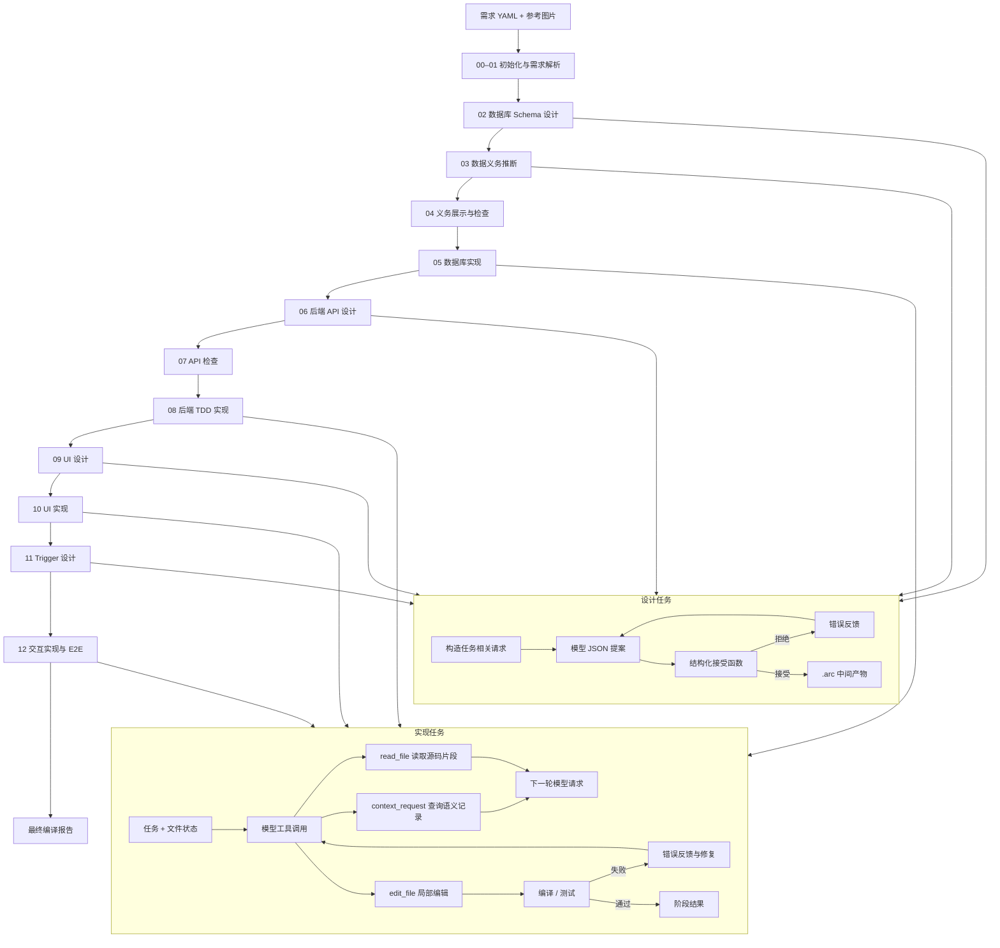
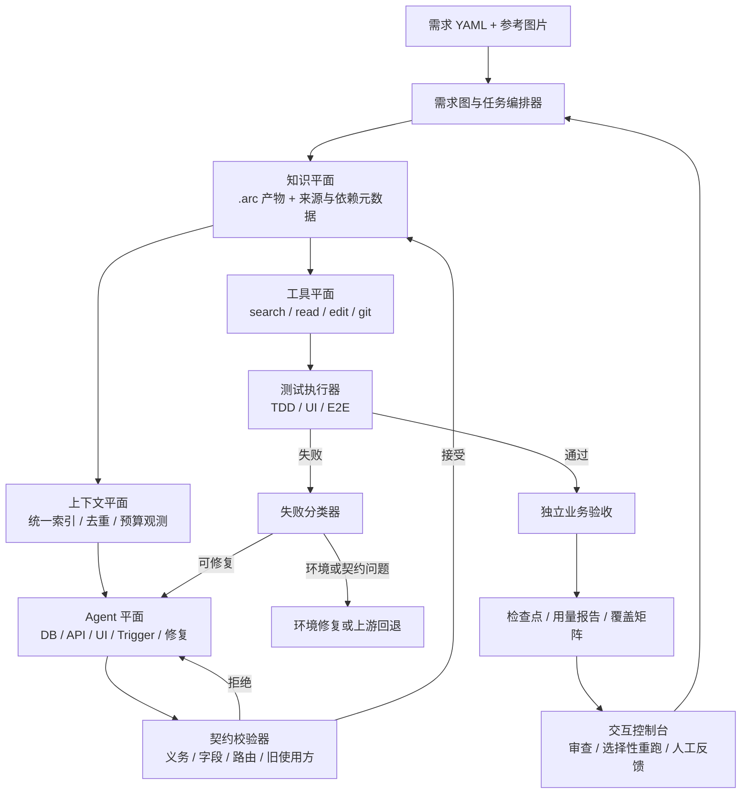

# 改进计划：面向准确率、消耗与交互性的需求编译 Agent

更新日期：2026-11-03  
分支：`cjq1`  
代码基线：`c998da3`（合并 `main` 的提交）  
范围：架构设计、优势与风险分析、分批代码修改策略、验收标准

---

## 1. 当前工作流

当前系统已经是一个确定性的 13 阶段编译流水线，并带有受限的模型修复循环。模型负责理解、设计和生成；程序负责阶段编排、文件权限、编译检查、测试验收和状态记录。



### 1.1 已有能力

| 能力 | 当前实现 |
|---|---|
| 固定编译流程 | `infrastructure/compiler.py` 顺序执行 13 个阶段 |
| 按需语义检索 | `DiscoverySession`、`ContextIndex` |
| 局部源码读取 | 文件 Agent 的 `read_file` |
| 局部文件修改 | 文件 Agent 的 `edit_file`，要求原文唯一匹配 |
| 数据义务约束 | schema、API、trigger 的读写集合检查 |
| 分层测试 | 后端 TDD、UI 展示测试、E2E、独立需求验收 |
| 失败继续执行 | 阶段失败记录后继续尝试后续阶段 |
| 文件检查点 | Git checkpoint 记录编辑、验收和阶段结果 |
| 共享约定 | `shared_conventions.json` 保持接口间一致性 |

### 1.2 尚未平台化的部分

1. 上下文构造逻辑分散在各阶段，查询协议和去重规则不统一。
2. `.arc` 保存产物内容，但缺少完整的来源、依赖和被消费关系。
3. 失败都会进入修复循环，缺少协议、环境、编译、契约和业务失败的分类处理。
4. 用量分散在调用日志和内存统计中，缺少默认保存的阶段和任务汇总。
5. 局部重跑依赖人工选择阶段入口，缺少自动影响分析。
6. 交互界面主要是日志和文件，缺少中间产物审查和受影响范围预览。

---

## 2. 目标架构

目标不是推翻 13 阶段流程，而是把系统升级为“统一上下文、带依赖图的知识库、失败分类修复、可复现评估”的编译系统。外层仍由程序控制，Agent 的自由度限制在理解、查询、设计和修改。



### 2.1 六个平面

| 平面 | 职责 | 主要组件 |
|---|---|---|
| 编排平面 | 阶段顺序、任务调度、失败后继续、选择性重跑 | `Compiler`、`ResumeManager` |
| 知识平面 | 保存中间产物、来源、依赖、版本和覆盖关系 | `.arc`、`ArtifactDependencyGraph` |
| 上下文平面 | 统一索引、任务上下文构造、无损去重、用量观测 | `ContextBroker` |
| Agent 平面 | 设计、实现、修复、独立验收 | 设计 Agent、文件 Agent、诊断 Agent |
| 工具平面 | 语义查询、源码读取、局部编辑、测试、检查点 | `DiscoverySession`、`FileTools` |
| 观测与交互平面 | 用量、失败、覆盖、审查、重跑范围 | `UsageRecorder`、控制台 |

### 2.2 任务卡模型

每个 Agent 任务使用统一的任务卡：

```text
任务卡
- stage：当前阶段
- task：任务 ID
- requirement_ids：相关需求
- allowed_paths：允许读取和修改的文件
- required_artifacts：必须提供的上游产物
- allowed_queries：允许查询的记录类型
- must_preserve_evidence：必须保留的需求原文、错误证据、源码片段
- acceptance：结构校验、编译、测试或独立业务验收
- budget：软预算和观测指标
```

任务卡由程序生成。Agent 不能自行扩大权限，也不能跳过验收。

---

## 3. 与当前工作流的区别

| 维度 | 当前代码 | 目标架构 |
|---|---|---|
| 流程 | 固定 13 阶段顺序执行 | 保留阶段语义，由任务编排器管理依赖和选择性重跑 |
| 上下文 | 部分阶段自行构造局部请求 | 所有 Agent 通过 ContextBroker 获取一致上下文 |
| 状态 | `.arc` 保存产物内容 | 产物记录来源、依赖、版本和被消费关系 |
| 修复 | 失败进入统一修复循环 | 先分类，再选择修复、回退、重跑或停止 |
| 验收 | 已有分层测试和独立验收 | 增加需求步骤到测试用例的覆盖矩阵 |
| 恢复 | 可按阶段入口重跑 | 依据依赖图选择受影响任务重跑 |
| 观测 | 日志和 checkpoint | 统一记录 token、时间、查询、编辑和失败类型 |
| 交互 | 查看日志和文件 | 审查中间产物、修正设计、预览影响范围 |

### 3.1 统一上下文代理

**目标**：把各阶段分散的上下文构造收敛到一个入口，统一处理索引、去重、版本和用量记录。

**实现要点**：

1. 记录类型统一为 `requirement`、`schema`、`obligation`、`api`、`page`、`ui_element`、`trigger`、`shared_convention`。
2. Agent 使用统一的 `context_request` 查询候选，再按 ID 读取完整记录。
3. 同一请求内相同记录只保留一份完整 payload，其他位置使用引用。
4. 源码按文件版本和行区间管理，重叠片段合并，原文逐字保留。
5. 每次查询记录类型、返回数量、重复数量和字符规模。

### 3.2 依赖图知识库

**目标**：让每个产物可追踪来源和影响范围，支撑安全的选择性重跑。

**元数据示例**：

```json
{
  "artifact": "backend_apis.json",
  "version": 17,
  "stage": "06_design_backend_apis",
  "task": "REQ-2",
  "depends_on": [
    {"kind": "requirement", "id": "REQ-2"},
    {"kind": "schema_entity", "id": "users"},
    {"kind": "obligation", "id": "REQ-2"}
  ],
  "produces": [
    {"kind": "api", "id": "API-register"}
  ],
  "consumed_by": [
    {"kind": "implementation_task", "id": "API-register"},
    {"kind": "trigger_task", "id": "REQ-2"}
  ]
}
```

**核心关系**：

```text
requirement -> schema -> obligation -> api -> trigger -> test
page -> trigger
shared_api -> historical_requirement
api -> backend_test
trigger -> e2e_test
```

### 3.3 失败分类修复

**分类**：

| 类型 | 示例 | 处理 |
|---|---|---|
| `ProtocolError` | JSON 格式错误、工具参数错误 | 返回字段级诊断和示例 |
| `EnvironmentError` | 服务未启动、依赖缺失、超时 | 修复环境，不进入代码修复 |
| `CompileError` | TypeScript、SQL、模块导入错误 | 读取相关源码后局部修复 |
| `ContractError` | 义务覆盖失败、字段不存在、共享 API 退化 | 回到设计或补充上游约束 |
| `TestFailure` | 业务断言失败 | 提供需求原文、期望值和实际值 |
| `ExpectedRed` | TDD 初始 501 失败 | 记录为正常阶段 |
| `NoProgress` | 相同错误或相同查询重复出现 | 换查询、扩大上下文或停止任务 |

### 3.4 可复现评估体系

每次运行保存统一 `RunRecord`：

```json
{
  "run_id": "...",
  "input_hash": "...",
  "code_version": "c998da3",
  "model_config_hash": "...",
  "stages": {
    "06_design_backend_apis": {
      "tasks": [
        {
          "task": "REQ-2",
          "calls": 3,
          "input_tokens": 19876,
          "cached_input_tokens": 5120,
          "output_tokens": 9400,
          "reasoning_tokens": 7200,
          "duration_seconds": 51.2,
          "context_queries": 2,
          "read_files": 1,
          "edit_rounds": 0,
          "result": "GREEN"
        }
      ]
    }
  },
  "final_status": "COMPLETED_WITH_FAILURES",
  "passed_tasks": 11,
  "failed_tasks": 1,
  "total_tokens": 184230,
  "total_duration_seconds": 312
}
```

评估指标包括最终状态、通过任务数、失败任务列表、总 token、缓存输入 token、输出 token、推理 token、调用次数、查询次数、修复轮数和端到端时间。

---

## 4. 理论收益与适用边界

### 4.1 收益机制

总成本可以表示为：

```text
总成本 = 模型输入 + 模型输出 + 无效重试 + 测试时间 + 重跑范围
```

| 机制 | 作用位置 | 预期效果 |
|---|---|---|
| 按需上下文 | 模型输入 | 项目变大后，上下文从全量项目缩小为任务相关子图 |
| 局部编辑 | 模型输出 | 修改一个函数时不再输出整个文件 |
| 契约校验 | 无效实现 | 设计错误在实现前被拦截 |
| 失败分类 | 无效重试 | 协议、环境和业务问题走不同路径 |
| 依赖图 | 重跑范围 | 失败或人工修改后只重跑受影响任务 |
| 评估体系 | 长期稳定性 | 防止单次请求变小但总消耗增加 |

### 4.2 准确率提升来源

1. 任务上下文包含当前需求原文、相关 API、相关页面、必要源码和错误证据，同时去除重复内容。
2. 字段、义务、路由、事件和旧使用方约束在进入实现前被检查。
3. 编译错误附带文件和行列；业务失败附带期望值和实际值；协议错误附带字段级诊断。
4. 独立验收直接依据原始需求生成测试，不读取应用源码，避免测试被实现同化。

### 4.3 适用边界

| 判断 | 强度 | 依据 |
|---|---|---|
| 可解释性和交互性提升 | 高 | 中间产物、依赖关系、失败原因显式化 |
| 中大型任务 token 降低 | 较高 | 按需上下文和局部编辑直接减少输入输出 |
| 无效重试减少 | 中高 | 失败分类和契约检查减少错误修复路径 |
| 时间降低 | 中 | 取决于重跑收益是否大于架构开销 |
| 准确率提升 | 中 | 来自信息完整和早期拦截，模型能力上限不变 |
| 小任务全面占优 | 低 | 索引、依赖图和统计存在固定开销 |

### 4.4 主要风险与保护措施

| 风险 | 保护措施 |
|---|---|
| 检索漏掉关键信息 | 保留需求原文、导航目标页面、共享 API 旧使用方、错误期望值和被修改源码 |
| 依赖图漏边导致漏回归 | 初期宁可多重跑；共享 API 变化时重跑所有历史使用方相关测试 |
| 失败分类错误 | 未知失败走保守修复路径 |
| 硬预算截断必要查询 | 先观测和软提示，硬预算仅作为实验开关 |
| 用摘要替代证据导致误修 | 首批只用无损去重；摘要替代原文不进入默认路径 |
| 架构固定开销超过收益 | 用固定样本对照总 token、总时间和通过率后再启用行为策略 |

---

## 5. 代码修改策略

### 5.1 总体原则

1. 不改 13 阶段主结构，先添加横切模块。
2. 先观测，再无损优化，最后行为优化。
3. 每批修改必须通过本地测试和固定样本对照。
4. 不通过删除测试、弱化断言或减少独立验收制造优化效果。
5. 省 token 的策略不得删除非重复证据。

### 5.2 新增模块

```text
infrastructure/shared/usage/recorder.py
infrastructure/shared/agent/context_broker.py
infrastructure/shared/artifacts/dependency_graph.py
infrastructure/shared/agent/failures.py
infrastructure/shared/project/resume.py
```

---

## 6. 实施批次

### 批次 0：修复当前测试基线

**目标**：建立可运行的本地基线。当前 `c998da3` 运行 153 项测试，报告 15 个 failure、35 个 error、1 个 skipped，后续优化必须先区分已有失败和新增失败。

**修改点**：

- `infrastructure/shared/agent/tools/`
- `infrastructure/shared/agent/loop.py`
- `infrastructure/stages/frontend/triggers/`
- `infrastructure/shared/project/git.py`
- `tests/`

**工作项**：

1. 统一文件工具协议，`FileTools.schemas()`、提示词、测试夹具和调用方使用同一格式。
2. 修复或改写过期接口测试，例如 `sync_implementations` 相关断言。
3. 修复导航依赖测试，保留目标页面 mount、数据加载、共享状态和 trigger 所有权断言。
4. 修复失败恢复测试，验证拒绝编辑 checkpoint、任务基线恢复和后续任务继续执行。
5. 修复 HTTP 超时兼容性测试，按锁定 SDK 的有效参数和返回值断言。

**验收**：

```powershell
uv run --offline --frozen python -X utf8 -m unittest discover -s tests
```

通过标准为 0 failure、0 error；原有 skipped 需记录原因。

---

### 批次 1：UsageRecorder

**目标**：完整记录每次模型调用、查询、读取和修复的消耗。

**数据结构**：

```python
@dataclass
class ModelUsage:
    stage: str
    task: str
    call_type: str
    model: str
    input_tokens: int | None
    cached_input_tokens: int | None
    output_tokens: int | None
    reasoning_tokens: int | None
    duration_seconds: float
    status: str
```

**接入点**：

- `infrastructure/shared/models/text.py`
- `infrastructure/shared/agent/proposals.py`
- `infrastructure/shared/agent/loop.py`
- `infrastructure/utils/presentation/logging.py`

**要求**：

1. 记录设计提案、提案修复、文件编辑、查询后的继续调用。
2. 区分供应商未返回 usage 和调用失败。
3. 记录轮内调用、查询次数、读取次数和编辑轮数。
4. 异常或中断退出时保存已记录内容。
5. usage 保存失败不得掩盖原始业务异常。
6. 输出保存到 `.arc/usage/usage.json`。

**验收测试**：

- mock 模型连续返回 `context_request`、`read_file`、`edit_file`，每次模型调用都被计数。
- 供应商无 usage 时记录 `None`。
- 异常退出后 usage 文件仍存在。
- usage 写入失败不影响原始错误类型。

---

### 批次 2：无损上下文去重

**目标**：减少重复内容，不删除任何非重复证据。

**修改点**：

- `infrastructure/shared/agent/proposals.py`
- `infrastructure/shared/agent/loop.py`
- `infrastructure/shared/models/text.py`
- `infrastructure/shared/agent/discovery.py`
- `infrastructure/shared/agent/context.py`

**工作项**：

1. payload 使用稳定排序和紧凑分隔符。
2. 动态错误放入 payload，系统提示保持稳定。
3. 同一记录只保留一份完整 payload，其他位置使用引用。
4. 候选列表保留摘要，不重复完整 payload。
5. 源码片段按文件版本和行区间合并。
6. 文件修改后旧片段失效。
7. 保留需求原文、错误期望值、实际值和源码原文。

**源码片段状态**：

```python
@dataclass
class ReadFileState:
    path: str
    version: str
    read_lines: set[int]
    excerpts: list[Excerpt]
```

**验收测试**：

- `[10, 30]` 与 `[20, 40]` 合并后只发送一次。
- 文件修改后旧片段失效。
- 换行符和空白逐字保留。
- 同一 API 被多个依赖引用时 payload 只出现一次。
- 失败测试的期望值和实际值保留。

---

### 批次 3：ContextBroker

**目标**：把分散的上下文构造逻辑收敛到统一入口。

**接口**：

```python
class ContextBroker:
    def register_records(...)
    def build_task_context(task_card: TaskCard) -> dict
    def resolve_query(query: dict) -> ContextResult
    def record_usage(...)
```

**迁移顺序**：

1. 第 11 步 trigger 设计：先迁移当前已经局部化的 `local_ui`、`existing_triggers`、`backend_apis`、`shared_conventions`。
2. 第 06 步 API 设计。
3. 第 08 步后端实现。
4. 第 09 步 UI 设计。
5. 第 10 步 UI 实现。
6. 第 12 步交互实现。

**验收测试**：

- 迁移前后任务上下文包含相同的关键 ID：requirement、page、api、trigger、convention。
- 上下文字符数下降。
- 非重复记录不丢失。
- 相关阶段测试通过。

---

### 批次 4：ArtifactDependencyGraph

**目标**：记录产物来源、依赖和被消费关系，支撑影响分析。

**接口**：

```python
class DependencyGraph:
    def upstream(node)
    def downstream(node)
    def affected_by(node)
    def invalidate(node)
    def select_rerun_tasks(changed_nodes)
```

**工作项**：

1. 新增 `save_artifact_with_metadata()`。
2. 优先迁移 `db_schema.json`、`db_obligations.json`、`backend_apis.json`、`ui_design.json`、`frontend_triggers.json`。
3. 建立正向和反向索引。
4. 测试覆盖记录进入依赖图。
5. 共享 API 记录所有历史使用方。

**验收测试**：

- schema 字段变化能找到相关义务。
- API 变化能找到 trigger 和测试。
- 页面变化能找到 trigger。
- 共享 API 能找到历史使用方。
- 无关需求不进入重跑范围。

---

### 批次 5：FailureClassifier

**目标**：先分类观测，再引入处理策略。

**第一阶段：只记录**

每次失败记录：

```json
{
  "failure_type": "CompileError",
  "stage": "08_implement_backend_tdd",
  "task": "API-register",
  "file": "backend/src/routes/register.ts",
  "line": 42,
  "message": "...",
  "round": 2,
  "will_retry": true
}
```

**第二阶段：处理策略**

| 类型 | 策略 |
|---|---|
| `ProtocolError` | 返回字段级诊断和示例 |
| `EnvironmentError` | 修复环境，不进入代码修复 |
| `CompileError` | 补充相关源码后局部修复 |
| `ContractError` | 回到设计任务或补充上游约束 |
| `ExpectedRed` | 记录为正常 TDD 阶段 |
| `NoProgress` | 换查询、扩大上下文或停止任务 |

**无进展规则**：

1. 第一次重复：提示模型调整查询。
2. 第二次重复：自动补充相关依赖。
3. 第三次重复：停止任务并记录失败。

该规则必须在批次 1 的 usage 数据确认重复确实存在后启用。

**验收测试**：

- JSON 格式错误分类为 `ProtocolError`。
- 服务未启动分类为 `EnvironmentError`。
- TypeScript 编译错误分类为 `CompileError`。
- 义务覆盖错误分类为 `ContractError`。
- TDD 初始 501 失败分类为 `ExpectedRed`。
- 同一错误三轮不变时任务停止并归档。

---

### 批次 6：ResumeManager

**目标**：失败或人工修改后，只重跑受影响任务。

**接口**：

```python
class ResumeManager:
    def load_state(...)
    def plan_rerun(changed_nodes)
    def mark_task_done(...)
    def mark_task_failed(...)
    def should_run(stage, task)
```

**修改点**：

- `infrastructure/compiler.py`
- `main.py`
- 各阶段入口

**运行模式**：

```powershell
python main.py --resume
```

**保守策略**：

1. 依赖不确定时视为受影响。
2. 共享 API 变化时重跑所有历史使用方相关测试。
3. 文件版本不匹配时重跑整个任务。
4. 测试覆盖映射缺失时重跑该阶段完整测试。

**验收测试**：

- 修改一个 API 只重跑相关后端实现、trigger 和 E2E。
- 修改 schema 会标记义务、API、页面和测试受影响。
- 未受影响需求不重跑。
- 全量重跑和选择性重跑最终业务测试结果一致。
- 依赖缺失时自动退回全量阶段重跑。

---

### 批次 7：实验性优化

这些功能默认关闭，通过固定样本对照后逐项启用。

| 实验 | 内容 | 启用条件 |
|---|---|---|
| 软预算 | 查询次数、重复率、已读规模提示 | 不改变行为，仅观测 |
| 硬预算 | 限制轮内调用或读取规模 | 固定样本通过率不变，总消耗下降 |
| 模型分级 | 简单任务使用更小模型 | 通过率不变，总成本下降 |
| 缓存 | 缓存确定性输入的响应 | 输入 hash、模型和参数一致；失败响应不缓存 |
| 确定性生成 | 简单 schema 和脚手架由代码生成 | 复杂约束自动回退模型 |

---

## 7. 提交粒度

| 提交 | 内容 | 类型 |
|---|---|---|
| PR 0 | 测试基线修复 | 必须先做 |
| PR 1 | UsageRecorder | 观测 |
| PR 2 | 紧凑 JSON 和重复记录去重 | 无损优化 |
| PR 3 | 源码片段合并 | 无损优化 |
| PR 4 | ContextBroker 骨架 | 架构 |
| PR 5 | 第 11 步迁移 ContextBroker | 架构 |
| PR 6 | 其他阶段迁移 ContextBroker | 架构 |
| PR 7 | ArtifactDependencyGraph | 架构 |
| PR 8 | FailureClassifier 观测 | 可靠性 |
| PR 9 | 失败处理策略 | 行为优化 |
| PR 10 | ResumeManager | 时间与交互优化 |
| PR 11 | 实验开关 | 实验 |

---

## 8. 最小可行版本

时间有限时优先完成五项：

1. 修复当前测试基线。
2. UsageRecorder。
3. 无损去重和源码片段合并。
4. ArtifactDependencyGraph 基础版本。
5. FailureClassifier 只记录。

这五项足以支撑目标架构汇报，并为进一步优化提供数据基础。

---

## 9. 统一验收标准

每批修改后运行：

```powershell
uv run --offline --frozen python -X utf8 -m unittest discover -s tests
```

并检查：

1. 不新增失败。
2. 关键证据没有丢失。
3. 文件权限没有弱化。
4. 测试没有被删除或弱化。
5. usage 指标完整。
6. 固定样本最终业务结果不变。
7. token 优化必须比较总 token、总时间、通过任务数和修复轮数，而不是只比较单次请求大小。

---

## 10. 当前基线记录

**版本**：`cjq1 c998da3`  
**环境**：Windows，CPython 3.13.5  
**命令**：

```powershell
uv run --offline --frozen python -X utf8 -m unittest discover -s tests
```

**结果**：153 项测试，15 个 failure、35 个 error、1 个 skipped，耗时 285.338 秒，退出码 1。

**代表性问题**：

| 问题 | 处理要求 |
|---|---|
| 测试仍引用已移除的运行时接口 | 按当前运行时合同改写，不删除业务断言 |
| 工具协议与测试夹具不一致 | 统一 schema、提示词、夹具和调用方格式 |
| 导航依赖测试失败 | 保留目标页面 mount、数据加载和 trigger 所有权断言 |
| 失败恢复与 Git 历史测试失败 | 先修工具协议，再验证 checkpoint 和恢复链路 |
| HTTP 超时兼容性失败 | 按锁定 SDK 的有效参数和返回值更新测试 |
| SQL/UI 产物缺失和状态分类失败 | 分组定位根因，区分级联错误和独立问题 |

---

## 11. 汇报口径

可以在汇报中按以下顺序说明：

1. 起点是固定 13 阶段需求编译流水线，已有结构化中间产物、义务检查、分层测试和失败继续执行。
2. 当前版本已引入按需检索、局部读取、局部编辑、共享约定和 Git checkpoint。
3. 改进方向是把分散机制平台化：统一上下文代理、依赖图知识库、失败分类修复和可复现评估。
4. token 优化遵循“先观测、再无损去重、再行为优化”的顺序。
5. 准确率优化依赖契约校验、分层测试和独立需求验收，不通过削弱测试实现。
6. 交互性来自中间产物审查、影响范围分析和选择性重跑。
7. 后续用固定输入和固定模型配置做配对运行，比较总 token、总时间、通过任务数和失败原因分布。
