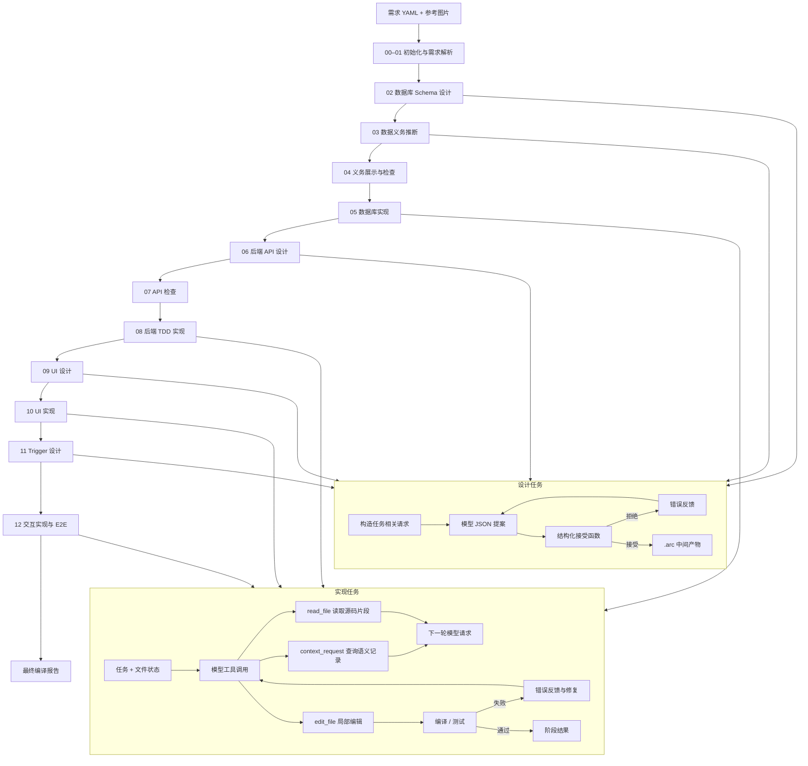
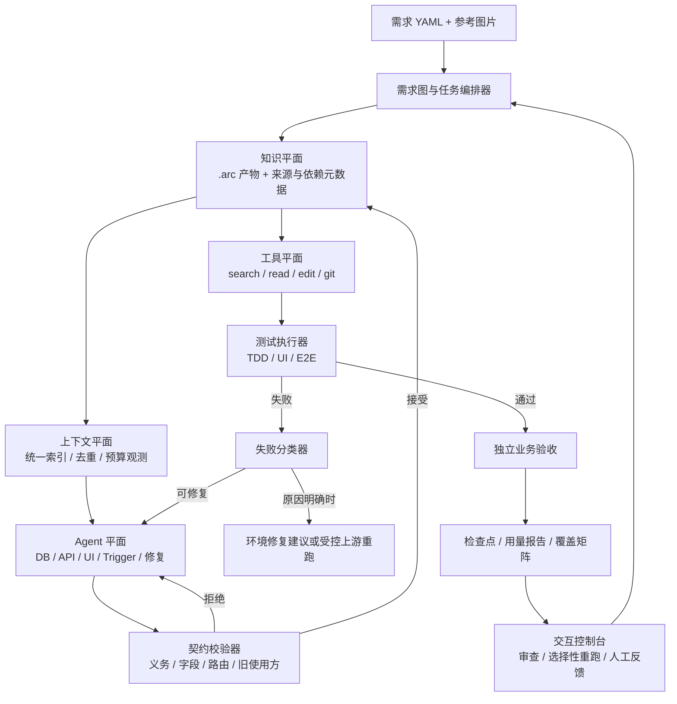

# 改进计划：面向准确率、消耗与交互性的需求编译 Agent

更新日期：2026-11-04
分支：`cjq1`  
代码基线：`c998da3`（合并 `main` 的提交）  
范围：架构设计、优势与风险分析、分批代码修改策略、验收标准

**实施状态**：批次 0–7 的代码已接入，最新实现与验证记录见第 13 节。前文保留方案设计，第 10、12 节保留阶段性基线，不能用历史状态判断当前进度。

---

## 1. 当前工作流

当前系统已经是一个确定性的 13 阶段编译流水线，并带有受限的模型修复循环。模型负责理解、设计和生成；程序负责阶段编排、文件权限、编译检查、测试验收和状态记录。



### 1.1 已有能力

| 能力 | 当前实现 |
|---|---|
| 固定编译流程 | `infrastructure/compiler.py` 顺序执行 13 个阶段 |
| 按需语义检索 | `DiscoverySession`、`ContextIndex` |
| 局部源码读取 | 文件 Agent 的 `read_file` |
| 局部文件修改 | 文件 Agent 的 `edit_file`，要求原文唯一匹配 |
| 数据义务约束 | schema、API、trigger 的读写集合检查 |
| 分层测试 | 后端 TDD、UI 展示测试、E2E、独立需求验收 |
| 失败继续执行 | 阶段失败记录后继续尝试后续阶段 |
| 文件检查点 | Git checkpoint 记录编辑、验收和阶段结果 |
| 共享约定 | `shared_conventions.json` 保持接口间一致性 |

### 1.2 尚未平台化的部分

1. 上下文构造逻辑分散在各阶段，查询协议和去重规则不统一。
2. `.arc` 保存产物内容，但缺少完整的来源、依赖和被消费关系。
3. 失败都会进入修复循环，缺少协议、环境、编译、契约和业务失败的分类处理。
4. 用量分散在调用日志和内存统计中，缺少默认保存的阶段和任务汇总。
5. 局部重跑依赖人工选择阶段入口，缺少自动影响分析。
6. 交互界面主要是日志和文件，缺少中间产物审查和受影响范围预览。

---

## 2. 目标架构

目标不是推翻 13 阶段流程，而是把系统升级为“统一上下文、带依赖图的知识库、失败分类修复、可复现评估”的编译系统。外层仍由程序控制，Agent 的自由度限制在理解、查询、设计和修改。



### 2.1 六个平面

| 平面 | 职责 | 主要组件 |
|---|---|---|
| 编排平面 | 阶段顺序、任务调度、失败后继续、选择性重跑 | `Compiler`、`ResumeManager` |
| 知识平面 | 保存中间产物、来源、依赖、版本和覆盖关系 | `.arc`、`ArtifactDependencyGraph` |
| 上下文平面 | 统一索引、任务上下文构造、无损去重、用量观测 | `ContextBroker` |
| Agent 平面 | 设计、实现、修复、独立验收 | 设计 Agent、文件 Agent、诊断 Agent |
| 工具平面 | 语义查询、源码读取、局部编辑、测试、检查点 | `DiscoverySession`、`FileTools` |
| 观测与交互平面 | 用量、失败、覆盖、审查、重跑范围 | `UsageRecorder`、控制台 |

### 2.2 任务卡模型

每个 Agent 任务使用统一的任务卡：

```text
任务卡
- stage：当前阶段
- task：任务 ID
- requirement_ids：相关需求
- allowed_paths：允许读取和修改的文件
- required_artifacts：必须提供的上游产物
- allowed_queries：允许查询的记录类型
- must_preserve_evidence：必须保留的需求原文、错误证据、源码片段
- acceptance：结构校验、编译、测试或独立业务验收
- budget：软预算和观测指标
```

任务卡由程序生成。Agent 不能自行扩大权限，也不能跳过验收。

---

## 3. 与当前工作流的区别

| 维度 | 当前代码 | 目标架构 |
|---|---|---|
| 流程 | 固定 13 阶段顺序执行 | 保留阶段语义，由任务编排器管理依赖和选择性重跑 |
| 上下文 | 部分阶段自行构造局部请求 | 所有 Agent 通过 ContextBroker 获取一致上下文 |
| 状态 | `.arc` 保存产物内容 | 产物记录来源、依赖、版本和被消费关系 |
| 修复 | 失败进入统一修复循环 | 先分类，再选择修复、回退、重跑或停止 |
| 验收 | 已有分层测试和独立验收 | 增加需求步骤到测试用例的覆盖矩阵 |
| 恢复 | 可按阶段入口重跑 | 依据依赖图选择受影响任务重跑 |
| 观测 | 日志和 checkpoint | 统一记录 token、时间、查询、编辑和失败类型 |
| 交互 | 查看日志和文件 | 审查中间产物、修正设计、预览影响范围 |

### 3.1 统一上下文代理

**目标**：把各阶段分散的上下文构造收敛到一个入口，统一处理索引、去重、版本和用量记录。

**实现要点**：

1. 记录类型统一为 `requirement`、`schema`、`obligation`、`api`、`page`、`ui_element`、`trigger`、`shared_convention`。
2. Agent 使用统一的 `context_request` 查询候选，再按 ID 读取完整记录。
3. 同一请求内相同记录只保留一份完整 payload，其他位置使用引用。
4. 源码按文件版本和行区间管理，重叠片段合并，原文逐字保留。
5. 每次查询记录类型、返回数量、重复数量和字符规模。

### 3.2 依赖图知识库

**目标**：让每个产物可追踪来源和影响范围，支撑安全的选择性重跑。

**元数据示例**：

```json
{
  "artifact": "backend_apis.json",
  "version": 17,
  "stage": "06_design_backend_apis",
  "task": "REQ-2",
  "depends_on": [
    {"kind": "requirement", "id": "REQ-2"},
    {"kind": "schema_entity", "id": "users"},
    {"kind": "obligation", "id": "REQ-2"}
  ],
  "produces": [
    {"kind": "api", "id": "API-register"}
  ],
  "consumed_by": [
    {"kind": "implementation_task", "id": "API-register"},
    {"kind": "trigger_task", "id": "REQ-2"}
  ]
}
```

**核心关系**：

```text
requirement -> schema -> obligation -> api -> trigger -> test
page -> trigger
shared_api -> historical_requirement
api -> backend_test
trigger -> e2e_test
```

### 3.3 失败分类修复

**分类**：

| 类型 | 示例 | 处理 |
|---|---|---|
| `ProtocolError` | JSON 格式错误、工具参数错误 | 返回字段级诊断和示例 |
| `EnvironmentError` | 已确认缺少依赖、权限或磁盘故障 | 记录环境证据，执行已定义的有界恢复 |
| `CompileError` | TypeScript、SQL、模块导入错误 | 读取相关源码后局部修复 |
| `ContractError` | 义务覆盖失败、字段不存在、共享 API 退化 | 回到设计或补充上游约束 |
| `TestFailure` | 业务断言失败 | 提供需求原文、期望值和实际值 |
| `ExpectedRed` | TDD 初始 501 失败 | 记录为正常阶段 |
| `NoProgress` | 相同错误或相同查询重复出现 | 换查询、扩大上下文或停止任务 |

服务未启动和超时是现象，SQL、导入、端口配置等生成代码问题也会导致这些现象。未知原因保留原代码修复路径；分类器先只记录，处理策略按对照结果逐项启用。

### 3.4 可复现评估体系

每次运行保存统一 `RunRecord`：

```json
{
  "run_id": "...",
  "input_hash": "...",
  "code_version": "c998da3",
  "model_config_hash": "...",
  "stages": {
    "06_design_backend_apis": {
      "tasks": [
        {
          "task": "REQ-2",
          "calls": 3,
          "input_tokens": 19876,
          "cached_input_tokens": 5120,
          "output_tokens": 9400,
          "reasoning_tokens": 7200,
          "duration_seconds": 51.2,
          "context_queries": 2,
          "read_files": 1,
          "edit_rounds": 0,
          "result": "GREEN"
        }
      ]
    }
  },
  "final_status": "COMPLETED_WITH_FAILURES",
  "passed_tasks": 11,
  "failed_tasks": 1,
  "total_tokens": 184230,
  "total_duration_seconds": 312
}
```

评估指标包括最终状态、通过任务数、失败任务列表、总 token、缓存输入 token、输出 token、推理 token、调用次数、查询次数、修复轮数和端到端时间。

---

## 4. 理论收益与适用边界

### 4.1 收益机制

总成本可以表示为：

```text
总 token = 所有尝试的输入 token 之和 + 所有尝试的输出 token 之和
总时间 = 从启动到最终报告的实际墙钟时间
费用 = 按实际供应商计费口径单独计算
```

| 机制 | 作用位置 | 预期效果 |
|---|---|---|
| 按需上下文 | 模型输入 | 项目变大后，上下文从全量项目缩小为任务相关子图 |
| 局部编辑 | 模型输出 | 修改一个函数时不再输出整个文件 |
| 契约校验 | 无效实现 | 设计错误在实现前被拦截 |
| 失败分类 | 无效重试 | 协议、环境和业务问题走不同路径 |
| 依赖图 | 重跑范围 | 失败或人工修改后只重跑受影响任务 |
| 评估体系 | 长期稳定性 | 防止单次请求变小但总消耗增加 |

### 4.2 准确率提升来源

1. 任务上下文包含当前需求原文、相关 API、相关页面、必要源码和错误证据，同时去除重复内容。
2. 字段、义务、路由、事件和旧使用方约束在进入实现前被检查。
3. 编译错误附带文件和行列；业务失败附带期望值和实际值；协议错误附带字段级诊断。
4. 独立验收直接依据原始需求生成测试，不读取应用源码，避免测试被实现同化。

### 4.3 适用边界

| 判断 | 当前评价 | 需要的验证 |
|---|---|---|
| 可解释性和交互性提升 | 设计合理，中间产物和追踪能力可直接检查 | 人工修正后的影响预览与审查流程可用 |
| 中大型任务 token 降低 | 存在机制依据，实际结果待测 | 计入额外查询、重复证据与失败重试的配对总量 |
| 无效重试减少 | 取决于归因和检索是否正确 | 分类准确性、最终成功率与总重试次数 |
| 时间降低 | 待测 | 模型、测试、Git、索引和重跑的端到端耗时 |
| 准确率提升 | 独立验收和契约提供保障路径，仍需业务对照 | 固定业务验收及 ARC-Bench 同版本评测 |
| 小任务收益 | 固定开销可能超过节省 | 保留原路径做同样本对照 |

最初 `13e78ef` 已有结构化中间表示、BM25 检索、义务校验与测试修复。当前方案的新增价值主要是工具式局部读取/编辑、共享约定、独立验收、失败继续与检查点，以及待实现的统一观测和依赖来源。汇报和实验按实际提交区分这些能力，避免重复计算已有机制的收益。

### 4.4 主要风险与保护措施

| 风险 | 保护措施 |
|---|---|
| 检索漏掉关键信息 | 保留需求原文、导航目标页面、共享 API 旧使用方、错误期望值和被修改源码 |
| 依赖图漏边导致漏回归 | 初期宁可多重跑；共享 API 变化时重跑所有历史使用方相关测试 |
| 失败分类错误 | 未知失败走保守修复路径 |
| 硬预算截断必要查询 | 先观测和软提示，硬预算仅作为实验开关 |
| 用摘要替代证据导致误修 | 首批只用无损去重；摘要替代原文不进入默认路径 |
| 架构固定开销超过收益 | 用固定样本对照总 token、总时间和通过率后再启用行为策略 |

---

## 5. 代码修改策略

### 5.1 总体原则

1. 不改 13 阶段主结构，先添加横切模块。
2. 先观测，再无损优化，最后行为优化。
3. 每批修改必须通过本地测试和固定样本对照。
4. 不通过删除测试、弱化断言或减少独立验收制造优化效果。
5. 省 token 的策略不得删除非重复证据。

### 5.2 新增模块

```text
infrastructure/shared/usage/recorder.py
infrastructure/shared/agent/context_broker.py
infrastructure/shared/artifacts/dependency_graph.py
infrastructure/shared/agent/failures.py
infrastructure/shared/project/resume.py
```

---

## 6. 实施批次

### 批次 0：修复当前测试基线

**目标**：建立可运行的本地基线。当前 `c998da3` 运行 153 项测试，报告 15 个 failure、35 个 error、1 个 skipped，后续优化必须先区分已有失败和新增失败。

**修改点**：

- `infrastructure/shared/agent/tools/`
- `infrastructure/shared/agent/loop.py`
- `infrastructure/stages/frontend/triggers/`
- `infrastructure/shared/project/git.py`
- `tests/`

**工作项**：

1. 统一文件工具协议，`FileTools.schemas()`、提示词、测试夹具和调用方使用同一格式。
2. 修复或改写过期接口测试，例如 `sync_implementations` 相关断言。
3. 修复导航依赖测试，保留目标页面 mount、数据加载、共享状态和 trigger 所有权断言。
4. 修复失败恢复测试，验证拒绝编辑 checkpoint、任务基线恢复和后续任务继续执行。
5. 修复 HTTP 超时兼容性测试，按锁定 SDK 的有效参数和返回值断言。

**验收**：

```powershell
uv run --offline --frozen python -X utf8 -m unittest discover -s tests
```

通过标准为 0 failure、0 error；原有 skipped 需记录原因。

---

### 批次 1：UsageRecorder

**目标**：完整记录每次模型调用、查询、读取和修复的消耗。

**数据结构**：

```python
@dataclass
class ModelUsage:
    stage: str
    task: str
    call_type: str
    model: str
    input_tokens: int | None
    cached_input_tokens: int | None
    output_tokens: int | None
    reasoning_tokens: int | None
    duration_seconds: float
    status: str
```

**接入点**：

- `infrastructure/shared/models/text.py`
- `infrastructure/shared/agent/proposals.py`
- `infrastructure/shared/agent/loop.py`
- `infrastructure/utils/presentation/logging.py`

**要求**：

1. 记录设计提案、提案修复、文件编辑、查询后的继续调用。
2. 区分供应商未返回 usage 和调用失败。
3. 记录轮内调用、查询次数、读取次数和编辑轮数。
4. 异常或中断退出时保存已记录内容。
5. usage 保存失败不得掩盖原始业务异常。
6. 输出保存到 `.arc/usage/usage.json`。

**验收测试**：

- mock 模型连续返回 `context_request`、`read_file`、`edit_file`，每次模型调用都被计数。
- 供应商无 usage 时记录 `None`。
- 异常退出后 usage 文件仍存在。
- usage 写入失败不影响原始错误类型。

---

### 批次 2：无损上下文去重

**目标**：减少重复内容，不删除任何非重复证据。

**修改点**：

- `infrastructure/shared/agent/proposals.py`
- `infrastructure/shared/agent/loop.py`
- `infrastructure/shared/models/text.py`
- `infrastructure/shared/agent/discovery.py`
- `infrastructure/shared/agent/context.py`

**工作项**：

1. payload 使用稳定排序和紧凑分隔符。
2. 动态错误放入 payload，系统提示保持稳定。
3. 同一记录只保留一份完整 payload，其他位置使用引用。
4. 候选列表保留摘要，不重复完整 payload。
5. 源码片段按文件版本和行区间合并。
6. 文件修改后旧片段失效。
7. 保留需求原文、错误期望值、实际值和源码原文。

**源码片段状态**：

```python
@dataclass
class ReadFileState:
    path: str
    version: str
    read_lines: set[int]
    excerpts: list[Excerpt]
```

**验收测试**：

- `[10, 30]` 与 `[20, 40]` 合并后只发送一次。
- 文件修改后旧片段失效。
- 换行符和空白逐字保留。
- 同一 API 被多个依赖引用时 payload 只出现一次。
- 失败测试的期望值和实际值保留。

---

### 批次 3：ContextBroker

**目标**：把分散的上下文构造逻辑收敛到统一入口。

**接口**：

```python
class ContextBroker:
    def register_records(...)
    def build_task_context(task_card: TaskCard) -> dict
    def resolve_query(query: dict) -> ContextResult
    def record_usage(...)
```

**迁移顺序**：

1. 第 11 步 trigger 设计：先迁移当前已经局部化的 `local_ui`、`existing_triggers`、`backend_apis`、`shared_conventions`。
2. 第 06 步 API 设计。
3. 第 08 步后端实现。
4. 第 09 步 UI 设计。
5. 第 10 步 UI 实现。
6. 第 12 步交互实现。

**验收测试**：

- 迁移前后任务上下文包含相同的关键 ID：requirement、page、api、trigger、convention。
- 对照这些记录的业务字段、原文、权限及版本；仅 ID 相同不足以保证信息保留。
- 骨架迁移以语义与权限等价为验收，后续去重再比较累计发送量；架构收敛本身不要求字符数下降。
- 非重复记录不丢失。
- 相关阶段测试通过。

---

### 批次 4：ArtifactDependencyGraph

**目标**：记录产物来源、依赖和被消费关系，支撑影响分析。

**接口**：

```python
class DependencyGraph:
    def upstream(node)
    def downstream(node)
    def affected_by(node)
    def invalidate(node)
    def select_rerun_tasks(changed_nodes)
```

**工作项**：

1. 新增 `save_artifact_with_metadata()`。
2. 优先迁移 `db_schema.json`、`db_obligations.json`、`backend_apis.json`、`ui_design.json`、`frontend_triggers.json`。
3. 建立正向和反向索引。
4. 测试覆盖记录进入依赖图。
5. 共享 API 记录所有历史使用方。

第一版只记录来源与影响预览，不启用自动跳过或回滚。除了实际读取/写入的记录，还要记录查询集合及其版本：一次未命中查询的结果也可能被后来新增的实体或接口改变。依赖不完整时标记为未知并保守重跑。产物与元数据成组发布，避免内容已更新而依赖索引仍旧。

**验收测试**：

- schema 字段变化能找到相关义务。
- API 变化能找到 trigger 和测试。
- 页面变化能找到 trigger。
- 共享 API 能找到历史使用方。
- 无关需求不进入重跑范围。

---

### 批次 5：FailureClassifier

**目标**：先分类观测，再引入处理策略。

**第一阶段：只记录**

每次失败记录：

```json
{
  "failure_type": "CompileError",
  "stage": "08_implement_backend_tdd",
  "task": "API-register",
  "file": "backend/src/routes/register.ts",
  "line": 42,
  "message": "...",
  "round": 2,
  "will_retry": true
}
```

**第二阶段：处理策略**

| 类型 | 策略 |
|---|---|
| `ProtocolError` | 返回字段级诊断和示例 |
| `EnvironmentError` | 原因确认后执行有界环境恢复，原因不明仍走现有修复路径 |
| `CompileError` | 补充相关源码后局部修复 |
| `ContractError` | 回到设计任务或补充上游约束 |
| `ExpectedRed` | 记录为正常 TDD 阶段 |
| `NoProgress` | 换查询、扩大上下文或停止任务 |

**无进展规则**：

1. 先比较文件/提案版本、错误内容与本轮新增证据，区分“错误相同但代码有推进”和“重复同一状态”。
2. 重复证据出现时提示改查或给出结果。连续停滞才进入现有有限外层重试；有用的新查询仍允许继续。
3. 补充依赖必须遵循任务读取范围。独立验收不能借此读取应用源码或修改公共测试设施。
4. 不使用“相同错误出现三轮”作为统一停止规则。新的提前终止策略默认关闭，以 usage 和失败样本验证后启用。

该规则必须在批次 1 的 usage 数据确认重复确实存在后启用。

**验收测试**：

- JSON 格式错误分类为 `ProtocolError`。
- 明确缺少依赖归为环境故障；生成 SQL/导入错误导致服务未启动仍进入代码修复；原因不明保留修复机会。
- TypeScript 编译错误分类为 `CompileError`。
- 义务覆盖错误分类为 `ContractError`。
- TDD 初始 501 失败分类为 `ExpectedRed`。
- 连续重复查询有界退出，随后返回结果或改查有效依赖仍能恢复；代码逐步推进时不因错误标题相同被终止。

---

### 批次 6：ResumeManager

**目标**：失败或人工修改后，只重跑受影响任务。

**接口**：

```python
class ResumeManager:
    def load_state(...)
    def plan_rerun(changed_nodes)
    def mark_task_done(...)
    def mark_task_failed(...)
    def should_run(stage, task)
```

**修改点**：

- `infrastructure/compiler.py`
- `main.py`
- 各阶段入口

**运行模式**：

```powershell
python main.py input --output-dir outputs/demo --resume
```

**保守策略**：

1. 依赖不确定时视为受影响。
2. 共享 API 变化时重跑所有历史使用方相关测试。
3. 文件版本不匹配时重跑整个任务。
4. 测试覆盖映射缺失时重跑该阶段完整测试。

**验收测试**：

- 修改一个 API 只重跑相关后端实现、trigger 和 E2E。
- 修改 schema 会标记义务、API、页面和测试受影响。
- 未受影响需求不重跑。
- 全量重跑和选择性重跑最终业务测试结果一致。
- 依赖缺失时自动退回全量阶段重跑。

---

### 批次 7：实验性优化

这些功能默认关闭，通过固定样本对照后逐项启用。

| 实验 | 内容 | 启用条件 |
|---|---|---|
| 软预算 | 查询次数、重复率、已读规模提示 | 不改变行为，仅观测 |
| 硬预算 | 限制轮内调用或读取规模 | 固定样本通过率不变，总消耗下降 |
| 模型分级 | 简单任务使用更小模型 | 通过率不变，总成本下降 |
| 缓存 | 缓存确定性输入的响应 | 输入 hash、模型和参数一致；失败响应不缓存 |
| 确定性生成 | 简单 schema 和脚手架由代码生成 | 复杂约束自动回退模型 |

上表中“软预算”只记录查询、读取、调用与字符规模；提示词加入进度提示也可能改变模型决策，应单独对照。ResumeManager 与硬预算现已接入，需显式启用。自动跨阶段回滚仍不在本轮范围内，延续此前“风险非常高的先不做”的约束。

---

## 7. 提交粒度

| 提交 | 内容 | 类型 |
|---|---|---|
| PR 0 | 测试基线修复 | 必须先做 |
| PR 1 | UsageRecorder | 观测 |
| PR 2 | 紧凑 JSON 和重复记录去重 | 无损优化 |
| PR 3 | 源码片段合并 | 无损优化 |
| PR 4 | ContextBroker 骨架 | 架构 |
| PR 5 | 第 11 步迁移 ContextBroker | 架构 |
| PR 6 | 其他阶段迁移 ContextBroker | 架构 |
| PR 7 | ArtifactDependencyGraph | 架构 |
| PR 8 | FailureClassifier 观测 | 可靠性 |
| PR 9 | 失败处理策略 | 行为优化 |
| PR 10 | ResumeManager | 时间与交互优化 |
| PR 11 | 实验开关 | 实验 |

---

## 8. 最小可行版本

时间有限时优先完成五项：

1. 修复当前测试基线。
2. UsageRecorder。
3. 无损去重和源码片段合并。
4. ArtifactDependencyGraph 基础版本。
5. FailureClassifier 只记录。

这五项足以支撑目标架构汇报，并为进一步优化提供数据基础。

---

## 9. 统一验收标准

每批修改后运行：

```powershell
uv run --offline --frozen python -X utf8 -m unittest discover -s tests
```

并检查：

1. 不新增失败。
2. 关键证据没有丢失。
3. 文件权限没有弱化。
4. 测试没有被删除或弱化。
5. usage 指标完整。
6. 固定样本最终业务结果不变。
7. token 优化必须比较总 token、总时间、通过任务数和修复轮数，而不是只比较单次请求大小。

---

## 10. 当前基线记录

**版本**：`cjq1 c998da3`  
**环境**：Windows，CPython 3.13.5  
**命令**：

```powershell
uv run --offline --frozen python -X utf8 -m unittest discover -s tests
```

**结果**：153 项测试，15 个 failure、35 个 error、1 个 skipped，耗时 285.338 秒，退出码 1。

**代表性问题**：

| 问题 | 处理要求 |
|---|---|
| 测试仍引用已移除的运行时接口 | 按当前运行时合同改写，不删除业务断言 |
| 工具协议与测试夹具不一致 | 统一 schema、提示词、夹具和调用方格式 |
| 导航依赖测试失败 | 保留目标页面 mount、数据加载和 trigger 所有权断言 |
| 失败恢复与 Git 历史测试失败 | 先修工具协议，再验证 checkpoint 和恢复链路 |
| HTTP 超时兼容性失败 | 按锁定 SDK 的有效参数和返回值更新测试 |
| SQL/UI 产物缺失和状态分类失败 | 分组定位根因，区分级联错误和独立问题 |

---

## 11. 汇报口径

可以在汇报中按以下顺序说明：

1. 起点是固定 13 阶段需求编译流水线，已有结构化中间产物、义务检查、分层测试和失败继续执行。
2. 当前版本已引入按需检索、局部读取、局部编辑、共享约定和 Git checkpoint。
3. 改进方向是把分散机制平台化：统一上下文代理、依赖图知识库、失败分类修复和可复现评估。
4. token 优化遵循“先观测、再无损去重、再行为优化”的顺序。
5. 准确率优化依赖契约校验、分层测试和独立需求验收，不通过削弱测试实现。
6. 交互性来自中间产物审查、影响范围分析和选择性重跑。
7. 后续用固定输入和固定模型配置做配对运行，比较总 token、总时间、通过任务数和失败原因分布。

---

## 12. 接管评估与实施记录（2026-11-04）

### 12.1 接管结论

接管分支为 `cjq1`，HEAD 为 `974e736`。仓库实际计划文件为 `improvement-plan.md`，未发现 `implement-plan.md`。接管时已有未提交代码和测试修改，本轮在其基础上继续修复，保留原有进度。

总体采用现有方案：保留 13 阶段编排、结构化检查和独立验收，先建立可运行基线，再记录实际消耗，随后实施无损优化。相较最初版本，局部读取和编辑为减少重复生成提供了机制，独立验收和检查点为定位与恢复提供了基础。净 token、时间收益及 ARC-Bench 分数提升仍需配对实验验证。

本次接管评估时，UsageRecorder、ContextBroker、ArtifactDependencyGraph、FailureClassifier 和 ResumeManager 均尚未实现；随后实施进展见第 13 节。

本轮同时收紧计划中的几个条件：失败原因确认后才归类为环境故障；依赖图初期只记录与预览影响范围；恢复时必须校验依赖与产物版本；新预算、自动回退和停止策略需要单独实验。相同错误标题连续出现三次不足以证明没有进展。

### 12.2 本轮代码修复

| 修复 | 行为与保留的约束 |
|---|---|
| 重复检索的终止路径 | 首次无进展返回纠正提示，连续重复则进入现有有界重试；修复捕获异常后持续查询的问题，保留多次有效检索能力 |
| 源码片段包含关系去重 | 已有范围覆盖新范围时保留已有片段，新范围覆盖旧范围时替换；不截断证据 |
| 前端导航上下文 | 恢复当前及目标页面的 mount 初始化依赖，递归补齐页面入口所需上下文；不扩大业务 trigger 的需求归属 |
| Trigger 失败诊断 | 在检查失败报告中保留具体原因，便于辨别缺失产物与编译/功能失败 |
| HTTP 超时参数 | 使用锁定 SDK 支持的标量超时，修复客户端构造兼容性问题 |
| 小文件编辑边界 | 明确 160 字符以内单函数桩可整体替换；较大文件仍禁止整体替换，协议说明与执行规则一致 |
| 测试接口同步 | 更新工具协议、运行时参数、日志常量和临时运行环境夹具，保留权限、恢复和独立验收断言 |

前端修复测试要求实际修改带缺陷标记的产物后才能通过。独立验收测试继续检查验收文件在应用修复阶段不可修改，并覆盖业务实现修复后仍失败时的报告。新增重复语义查询、重复读取、包含范围读取和较大文件整篇替换拒绝测试。

### 12.3 验证结果

接管后首轮完整回归为 176 项测试，11 个 failure、3 个 error、2 个 skipped；当时已包含初步检索和超时修复，因此这不是接管前原样快照。第 10 节保留此前版本的历史基线。

本轮最终验证命令：

```powershell
.\.venv\Scripts\python.exe -X utf8 -m unittest discover -s tests
```

结果：**181 项测试，0 failure、0 error、2 skipped，耗时 281.888 秒**。两项跳过分别涉及真实 HTTP 和数据库运行时依赖，需要配置生成应用的 Node 依赖路径（`ARC_DB_TEST_NODE_MODULES`）后验证。本轮没有运行真实模型编译或提交 ARC-Bench，单元回归通过不等同于业务评测通过率已提升。

### 12.4 当时的后续工作安排

批次 0 的本地单元回归基线已恢复。下一批先实现 UsageRecorder，仅增加观测，记录所有成功、失败和重试请求的用量、耗时与结果，再执行固定样本配对运行。

当时仍需关注：trigger 实现要求提供的实现路径实际存在，文件存在本身不能证明接线正确；应结合原生入口、注册关系和行为测试验证。`context_result` 与累计证据之间的重复内容随后由可逆引用去重处理。

---

## 13. 全批次实施记录（2026-11-04）

### 13.1 实现清单

| 批次 | 已落地内容 | 入口 |
|---|---|---|
| 0 | 恢复基线，修复检索停滞、导航初始化依赖和过期测试接口 | 第 12 节 |
| 1 | 持久用量、阶段/任务汇总、查询/读取/编辑轮数、传输重试计数、中断保存 | `shared/usage/recorder.py`、`usage/session.py`、`presentation/model_io.py` |
| 2 | 紧凑稳定 JSON、重复对象及长字符串引用、包含与重叠源码片段合并、文件版本失效、错误移至 payload | `agent/context_broker.py`、`models/text.py`、两个 Agent 循环 |
| 3 | TaskCard、统一上下文构造、受限索引代理、查询统计；设计和文件 Agent 共用调用入口 | `agent/context_broker.py`、`agent/execution.py` |
| 4 | 产物来源/版本、正反向依赖、共享 API 使用方、查询集合版本、覆盖关联、影响预览 | `artifacts/dependency_graph.py`、`artifacts/coverage.py` |
| 5 | 协议、环境、编译、契约、业务、初始 RED、停滞及未知分类；默认记录，修复建议需显式启用 | `agent/failures.py`、两个 Agent 循环、后端初始 RED 检查 |
| 6 | 快照校验、恢复预览、完成阶段复用、设计重新接受、文件任务实时 gate 校验、失败后继续修复 | `project/resume.py`、`compiler.py`、`main.py` |
| 7 | 显式硬预算、指定任务模型路由、验收后缓存、简单 schema 显式生成与复杂约束回退 | `agent/experiments.py`、`models/text.py`、`main.py` |

表中的相对路径均位于 `infrastructure/`。API、UI、trigger 设计及后端、UI、交互实现通过共享 Agent 入口完成迁移，保留原阶段生成的局部上下文与 FileTools 权限规则。

### 13.2 默认运行行为

保留 13 阶段、需求原文、现有验收检查和独立验收。默认启用观测、紧凑序列化、可逆去重、源码片段合并和依赖记录。未启用硬预算、小模型路由、响应缓存、确定性 schema 或自动回滚。

相同对象及长字符串只发送一份，重复位置使用 JSON Pointer 形式的 `$context_ref`。`expand_context()` 可还原等价输入，协议明确引用指向相同完整证据。用户数据本身含该标记时整份输入不做引用替换；引用比原文更长时不替换。模型仍需理解引用，因此实际任务通过率仍需配对验证。

源码片段在文件版本、权限和其他元数据一致且重叠文字一致时才合并。规范化源码任意位置变化都会使旧版本片段失效。读取遵循既有 `read_source()` 的换行归一规则，合并操作保留读取结果的空白与换行。

动态错误保留在请求的 `correction`/`feedback` 中，固定修复协议不再拼入具体错误，避免同一错误同时出现在系统提示和 payload。

### 13.3 运行产物与统计口径

| 文件 | 内容 |
|---|---|
| `.arc/usage/usage.json` | 本次运行的调用、已报告 token、耗时、阶段和任务结果、查询/读取/编辑事件、重复记录/结果数量、字符规模及失败分类 |
| `.arc/dependencies.json` | 产物和记录版本、来源阶段、正向依赖、有效性和待提交标记；反向索引在加载时重建 |
| `.arc/resume.json` | 输入/代码/配置指纹、完成阶段结果、输出快照、已接受设计和文件任务快照 |
| `.arc/resume-plan.json` | 本次影响预览、变化文件、人工修改产物及计划重跑阶段 |
| `.arc/coverage.json` | 需求/步骤与候选测试套件、trigger、流程状态和独立验收状态的关联 |

供应商未返回的用量保持 `null`，真实零值保留。缓存输入属于输入子集，推理 token 属于输出子集，不额外加到总 token 中。SDK 内重试会另外记录 HTTP 尝试；中间尝试的用量未知时标记统计不完整，不能据此宣称已测得总账单。零模型调用的运行记录零消耗。

用量在调用与事件后写入；写入失败不覆盖业务异常。usage 和恢复状态不加入生成项目的 Git checkpoint，避免每次计数改变项目历史。依赖元数据以 `pending → 内容发布 → 元数据完成` 的可恢复事务发布；中途失败保留 pending，恢复时禁止跳过。

覆盖矩阵区分“套件归属”与“已验证断言覆盖”。尚未逐步骤测量的断言明确标记 `NOT_MEASURED`，不把某需求套件 GREEN 推断为该需求每一步都有有效断言。

### 13.4 恢复、审查和人工修改

```powershell
# 完整运行，生成观测、依赖和恢复状态
uv run main.py input --output-dir outputs/demo

# 只预览，不调用模型、不执行阶段
uv run main.py input --output-dir outputs/demo --resume-preview
uv run main.py input --output-dir outputs/demo --resume-preview --changed-node api:API-register

# 执行版本检查后的恢复
uv run main.py input --output-dir outputs/demo --resume
```

恢复同时检查输入目录、编译器及模板、模型配置、产物和源码快照。输入或配置变化、未知依赖、丢失元数据、pending 发布、无法追踪的文件变化均采用保守重跑。失败阶段会重新执行。

阶段共享可变产物，当前实际调度采用受影响阶段及后续阶段的保守范围，不宣称已经实现任意任务 DAG 的最小重跑。阶段内另有细粒度复用：设计提案须匹配上下文与索引版本并重新经过 `accept()`；文件任务须匹配源码、权限及实际查询集合版本，并再次运行当前 gate。gate 失败时把真实错误送入常规修复。依赖图的语义影响预览能区分共享 API 的历史使用方和无关需求。

人工修改 `db_schema.json`、`db_obligations.json`、`backend_apis.json`、`ui_design.json`、`frontend_triggers.json` 等中间产物时，保留修改内容，从其消费者阶段开始检查与重跑。删除或损坏产物则回到保守恢复路径。该机制不自动修改上游契约或撤销人工编辑。

### 13.5 实验开关

所有行为实验都需显式指定：

| 参数 | 行为 |
|---|---|
| `--context-dedup` | 显式启用引用去重；默认使用字面量证据 |
| `--no-context-dedup` | 显式保留默认字面量路径，兼容已有命令；与 `--context-dedup` 互斥 |
| `--experimental-max-task-calls N` | 限制每个任务的逻辑请求与额外 SDK/HTTP 重试尝试；不截断响应或删去证据 |
| `--experimental-max-read-characters N` | 限制任务内 `read_file` 累计读取字符数，超出时返回错误而不是残缺源码 |
| `--experimental-small-model MODEL --experimental-small-model-task LABEL` | 仅对精确匹配的文本任务标签路由，任务参数可重复指定；兼容性状态按模型隔离 |
| `--experimental-cache-dir PATH` | 对相同端点、文本模型、参数、输出协议、提示和输入缓存；结构解析与语义/gate 验收后才发布，拒绝后删除 |
| `--experimental-deterministic-schema PATH` | 将按需求 ID 索引的显式简单类型声明编译为完整 schema 提案，仍经过现有接受函数；存在引用、复杂约束或无效定义时回退模型 |
| `--experimental-failure-advice` | 在原始错误之外补充分类建议，保留原权限、验收及重试边界 |

文本模型路由不自动猜测任务难度；视觉调用仍使用 `VISUAL_MODEL` 配置。确定性 schema 从显式审查过的类型声明生成，不从自然语言猜测实体。例如：

```json
{
  "REQ-1": {
    "entities": {
      "Item": {
        "fields": {
          "id": {"type": "integer", "primary_key": true},
          "title": "string"
        }
      }
    }
  }
}
```

编译器补齐 description、nullable、primary_key、unique、references 和 constraints，并自动关联这些字段。该声明格式规定默认非空、非主键；unique 默认与 primary_key 一致，references 为 null、constraints 为空。属性可显式指定。已有完整字段提案仍兼容；关系和复杂业务约束由模型分析。`{"REQ-1":{"entities":{},"related_fields":[]}}` 只适用于人工确认该需求无需新增持久数据的情况。

高风险自动回滚、自动改写上游契约、摘要替代需求原文和默认缩短修复预算未加入默认行为，延续先前的风险约束。

### 13.6 配对评估入口

```powershell
uv run main.py input --output-dir outputs/baseline --no-context-dedup
uv run main.py input --output-dir outputs/candidate --context-dedup
uv run python -m infrastructure.shared.usage.compare outputs/baseline outputs/candidate --output comparison.json
```

比较工具检查输入指纹、usage 完整性、编译与分层验收状态，并列出 token、调用数、时间差和结果变化。用量未知、输入不一致或结果不同均不能作为等结果成本对照。真实模型运行有波动，需要重复配对；本地 mock 回归不用于推算 ARC-Bench 分数或 token 节省比例。

### 13.7 验证记录

接入主链路后的首次完整回归：181 项，0 failure、0 error、2 skipped，246.068 秒。

随后找到现有 `outputs/demo/node_modules`，配置 `ARC_DB_TEST_NODE_MODULES` 补跑真实运行时检查：HTTP→后端→SQLite 接线 1 项通过；数据库运行与修复组 9 项通过（87.171 秒）。补跑修复了过期的 `prepare_runtime` 参数、已移除的前端运行时类型引用，以及测试夹具的整文件替换响应。夹具现在生成唯一匹配的局部编辑，原有编译、HTTP 状态/正文/响应头、数据保留和真实启动断言保留。

恢复合同组 9 项独立通过（286.860 秒）；模型路由、缓存、预算等实验合同 8 项通过；重复观测和简写 schema 编译专项 3 项通过。恢复测试会验证代码指纹，源码变化时应重新开始对应对照，避免把保护性全量重跑误判为选择性调度错误。

最终完整验证命令：

```powershell
$env:ARC_DB_TEST_NODE_MODULES = (Resolve-Path outputs/demo/node_modules).Path
.\.venv\Scripts\python.exe -u -X utf8 -m unittest discover -s tests -v
```

**最终结果：224 项测试，0 failure、0 error、0 skipped，耗时 573.916 秒，退出码 0。** 日志保存于 `.test-tmp/frozen-final-all.log`。`git diff --check` 通过，分支保持 `cjq1`。合法 JSON 但结构错误的恢复状态、依赖元数据和缓存也有专项回退检查。

本轮完成批次 0–7 的代码接入及本地验证。未执行真实模型的成本配对运行或 ARC-Bench 提交，实际 token/时间收益与平台分数仍以之后的实测为准。自动跨阶段回滚及上游契约自动改写继续遵循此前的高风险排除约束；当前恢复使用保守阶段范围与任务复验。

### 13.8 最终架构复核与恢复一致性修复

2026-11-04 复核编排、上下文、读写权限、产物依赖、验收、统计及恢复边界，新增用例复现了两项恢复问题：

1. 变化阶段重跑完成后会推进全局快照；若进程在后续阶段执行前退出，旧的成功状态可能使这些阶段在下次启动时被复用。
2. 重跑后缀原先采用状态 JSON 的键顺序；键被重新排列时，后续阶段可能遗漏。

修复方式为：运行激活时先持久化整段待重跑阶段的 `PENDING` 状态；阶段入口写入 `RUNNING`，完成后更新结果与快照。状态识别包含 `PENDING`，调度顺序按阶段编号排序。只读预览保持原有恢复日志不变。

新增 `tests/test_resume_journal.py`，覆盖阶段间退出、运行中状态落盘、JSON 键重排和预览只读性，4 项通过。修复后完整回归 **228 项通过，0 failure、0 error、0 skipped，573.212 秒，退出码 0**，日志为 `.test-tmp/architecture-review-all.log`。README 已追加当前架构的实现流程、组件分工、设计依据与亮点。

### 13.9 用户实测成本回退与默认策略调整

2026-11-04，用户反馈当前运行总 token 约为 `main` 基线的 3 倍。本轮先核对实际代码差异；工作区现有输出及两个源码压缩包未提供这两次运行的成对用量记录，增量的阶段和调用归因待补齐。当前成本优化目标未达成，前述功能回归结果单独记录。

本轮确认并处理的事项：

1. **重复源码回传**：文件读取后的源码同时进入 `read_files` 和 `context_result.tool_results`，后者为新增回退。现在源码只留在 `read_files`，结果通知保留 `read_paths`。扩展读取工具的独立结果继续完整回传。读取版本校验、权限及真实 Gate 保留。
2. **引用编码默认开启依据不足**：`intern_context()` 的可还原测试验证宿主侧数据等价；模型理解引用的推理开销与修复率尚无配对数据。`OptimizationOptions.context_dedup` 改为默认关闭，新增 `--context-dedup` 显式实验参数；旧 `--no-context-dedup` 命令继续支持，两参数互斥。
3. **无条件协议开销**：原先所有文本和视觉请求的公共输出规则都含引用说明。现在公共规则恢复为普通 JSON 输出协议，文本请求仅在实际生成引用后追加说明；用户数据中的同名标记仍按字面量处理。

同时确认两项需要在成本评估中分开解释的行为：恢复及任务复用主要减少重复运行开销；前端挂载触发器补齐属于功能修复，可能增加完成同一需求所执行的工作。它们与单次上下文压缩分别统计。本轮保持验收标准、修复预算、模型配置与功能修复逻辑。

验证：优化平台 **32** 项、查询进展 **4** 项、报告及 CLI **5** 项、模型日志 **19** 项、文件任务 **14** 项、文件工具 **12** 项，合计 **86 项通过**。新增测试验证默认字面量传输、按实际引用附加规则、CLI 显式启用与互斥；已有工具扩展用例确认独立证据继续返回。README 的默认行为及成本现状已同步。

下一次成对分析应使用相同输入、模型及推理配置，记录两次完成阶段与验收结果，并拆分总调用数、各阶段输入/输出 token、推理 token 子集、修复轮数和传输重试。以整次编译总 token 与通过结果评价引用编码收益，字符缩减仅作为请求规模指标。本轮尚未获得修正后真实模型成本结果。

### 13.10 ARC-Bench 实测归因

已读取用户指定的运行 0c3f285db6e0 及 main 基线 f9b3b8578c12 的 stdout、compiler.log 与提交包。119 个基线运行时文件与 main 一致，需求 YAML 相同；本次按 README 架构分析写入前上传的 1104_1.zip 分析。总 token 为 3,490,470 对 1,090,916，即 3.20 倍；调用数为 169 对 80。逐调用汇总与平台总计一致。

新增 2,399,554 token 中，UI 实现贡献 631,915，E2E 与独立验收贡献 1,632,578，两者占 94.4%。已离线复现 UI 任务的现有文件目标绑定缺陷：先前任务创建未登记页面后，后续合法 replace 无法更新目标路径，pending_target 持续为 true，Gate 前反复被拒绝。注册页和登录页各耗尽 10 轮。该缺陷也存在于 main，本次生成的页面分工触发了它。

E2E 还出现两个注册接口的测试等待分歧和整页导航导致响应体失效；最终生成实现通过双 POST 加幂等键兼容两个接口，并切换客户端导航。独立验收修复合计 1,116,489 token。下一步优先修复目标绑定、检查共享业务操作的接口/测试一致性，再评估查询与引用编码成本。此前将引用编码视为主要怀疑项，现有实测应把修复循环与流程一致性放在首位。

完整数据、日志定位、复现与建议见 [token-regression-analysis.md](token-regression-analysis.md)。本轮为只读归因与临时目录复现，未修改运行时代码。

### 13.11 token 回退问题的 debug 实现与验证

2026-11-04 完成以下修改：

1. **已有目标认领**：新增 `bind_target`，显式登记已存在的可写页面/API/测试文件。校验目标目录、固定路径、测试后缀、权限和同类归属；与批次编辑一起发布，异常恢复索引、内存目标和源码。认领后仍执行 Gate。`tests/test_target_binding.py` 的 8 项回归包含三页面占位流程、认领后的真实失败修复、权限隔离及发布异常回滚。
2. **验收的传输过约束**：独立验收生成/审核去除生成 API URL、响应约定与全局模型约定作为测试依据，保留原始显式 HTTP 合同、成功/拒绝/身份隔离/持久化断言。过程测试继续检查真实 HTTP 接线；实现提示明确禁止用旧新接口双发兼容无需求依据的 URL 假设。
3. **重复请求与导航观察**：新增编译器只读测试工具 `observeMutations`，在用户动作及可见业务完成期间收集同源变更请求，可按业务数据匹配，跨接口双发仍计为两次。真实 Chromium 回归验证单请求、双接口请求、整页导航、操作失败及观察器错误时的清理，并通过 TypeScript 编译。
4. **旧验收套件迁移**：按 `oracle_policy=2` 对旧套件进行一次独立需求审查，审查仍走修改审计与 TypeScript Gate，行为失败继续交应用修复；应用修复不能修改独立套件。不自动跨阶段改写上游 API。
5. **查询反馈缺口**：预登记哈希验收路径并映射回原始需求，修复 `test_requirement` 查询缺失；重复缺失 ID 的不同排列不再构成新证据。受限读取范围通过 `allowed_read_paths` 和错误详情显式提供，保留原文件权限。

独立验收组 4 项、目标绑定组 8 项、查询进展组 6 项、前端流程组 24 项、真实浏览器请求观察 1 项、文件工具组 12 项等专项验证通过。新增测试共 13 项。

最终验证覆盖 244 项：全量运行 614.676 秒，243 项通过，唯一错误来自旧数据库测试仍从 `context_result.tool_results` 读取已去重的源码；已将同一可写权限断言迁移到 `read_files`，最终数据库修复协议组 3 项全部复测通过。运行时代码自全量验证开始保持不变，当前测试范围内没有未解决失败；未跳过真实 HTTP、SQLite 或 Chromium 检查。日志：`.test-tmp/debug-regression-all.log`、`.test-tmp/debug-database-protocol-final.log`。

测试结束后重新复核目标状态、读写范围、独立测试依据、请求观察生命周期及恢复交接，并更新 README 的架构分工与实现流程。本轮验证消除了已复现的目标登记空转并覆盖相应测试边界；实际模型调用量与总 token 是否低于 main，仍按修正后的配对运行评价。
